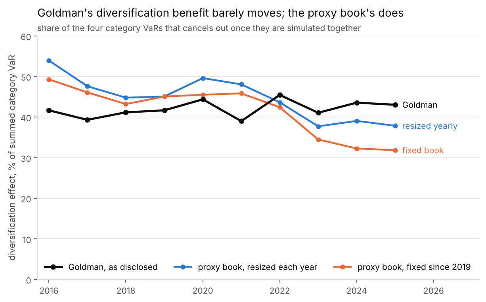
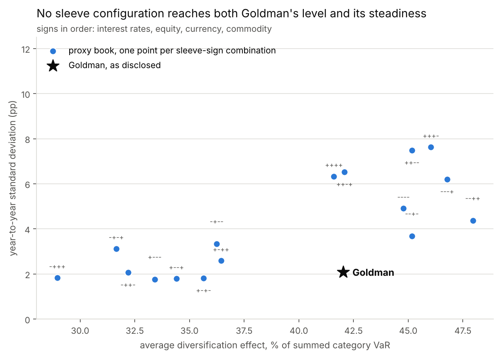

# Reconstructing Goldman Sachs's disclosed VaR model

Goldman Sachs publishes more about its Value-at-Risk model than it has to. Every
10-K gives the methodology in plain language (one-day horizon, 95% confidence,
historical simulation with full revaluation, five years of scenarios, weighted
so that older observations matter less), the average daily VaR split across
four risk categories, a separate line
reconciling those four figures to the firmwide number, and a count of the days
on which a loss exceeded the previous day's VaR.

This project takes that description seriously enough to rebuild it. A
historical-simulation engine runs on seventeen public risk factors, held in a
proxy book sized so that each sleeve's risk matches Goldman's disclosed
category split, and the output is compared against what Goldman reports.

## What this is not

It is not a reconstruction of Goldman's trading book. Positions are not
disclosed at any level of detail and never will be. What the filings pin down
is the *relative* size of four buckets of market risk, and that is enough to
build a portfolio of public instruments whose risk is divided the same way.
Everything here follows from that and nothing more.

The dollar level of this book carries no information either: it is a
normalisation chosen so the tables read in familiar units. The quantities worth
comparing are ratios and behaviour, not magnitudes.

## Research question

Goldman's disclosed diversification effect, defined in the filings as the
difference between total VaR and the sum of the four category VaRs, has sat
between 39.0% and 45.5% of the summed category VaRs for ten consecutive years,
with a standard deviation of 2.1 percentage points across a sample containing
both the COVID crash and the 2022 rate shock.

Can a historical-simulation engine built on free data, calibrated to the same
risk-category split, reproduce that number, its stability, and the backtesting
behaviour of a well-calibrated 95% model?

## What came out of it

**The level is reproducible; the stability is not.** At Goldman's own disclosed
five-year window, a book sized once on 2019 and then left alone averages 41.6%
against Goldman's 42.0% — a gap of four tenths of a point over ten years. Its
year-to-year standard deviation is 6.33 percentage points against Goldman's
2.08, and it drifts steadily downward (1.5 points a year, p = 0.002) where the
disclosure has no trend at all.

**Using Goldman's own weighting makes the stability gap worse, not better.**
The filings state that the historical data is weighted so older observations
matter less. Implementing that at the disclosed window raises the year-to-year
standard deviation from 6.33 to between 9.46 and 10.04, four to five times
Goldman's 2.08 — while simultaneously taking the engine from decisively failing
its coverage tests to passing them (exception rate 6.98% to 5.45%, Kupiec p
below 0.0001 to 0.328). The replication is not losing because it uses a blunter
method than the bank. It uses the bank's method, and the steadiness still is
not there.

**Nor can sleeve direction recover it.** Run the fixed book through all sixteen
ways the four sleeves can be signed and the two properties trade off: five
configurations are at least as steady as the disclosure and none of those
averages above 35.6%, while eight average 40% or more and the steadiest of
those still swings by 3.68 points a year. None reaches both corners.

**A five-year equally weighted window is too slow to be usable.** Over
2016-2025 the engine produced 160 exceptions in 2,293 days, a rate of 6.98%
against a nominal 5%, which Kupiec rejects outright, and the failures arrive in
heaps: 70 of them in 2022 alone, out of 230 trading days. In that year the
realised daily profit and loss had a standard deviation of 90.8 against an
average VaR of 63.1, because five years of scenarios in early 2022 reached back
to 2017 and contained almost no rate volatility. By 2025 the error reverses and
VaR runs at 1.47 times what contemporaneous volatility calls for, because the
2022 observations are still in the window.

**Two cheap corrections repair the coverage, and neither touches the
diversification result.** Goldman's own age weighting is one. Hull-White
volatility rescaling is the other, and it passes all three tests at both
confidence levels, reaching the Basel green zone at 99% (Kupiec p = 0.40,
independence p = 0.57, conditional coverage p = 0.59) where plain simulation
spends 18.2% of its days in the red zone and peaks at 73 exceptions in a
250-day window against a red threshold of 27. Both corrections change the
scale of the scenario set; neither changes its correlation structure, which is
what the diversification effect depends on.

**Full revaluation is worth about three tenths of a percent here.** Repricing
the bond sleeve by discounting its cashflows at the shocked yield, rather than
multiplying by modified duration, moves VaR by 0.25% to 0.59% a year, with a
largest single day of 1.55%. Convexity is not why one-day VaR needs full
revaluation on a book of vanilla bonds. It is why a book with options does.

**A negative result worth keeping.** The fixed book's year-over-year VaR path
does not track Goldman's: five of nine years move in the same direction,
Spearman's rho is 0.32 (p = 0.41). Holding exposures still and letting only market
volatility move does not reproduce their path, and the filings say why.
Goldman's own explanation of its VaR change has the same shape in four
consecutive years, 2021 through 2024: volatility moved one way, "partially
offset by" exposures moving the other. A static book cannot reproduce a path
produced by a desk trading against the market.





## Reproducing it

```bash
pip install -r requirements.txt
make all
```

`make all` runs seven stages in order. The first downloads ten 10-K filings from
EDGAR and parses the disclosure tables out of them; the rest need no network.
Expect about fifteen minutes end to end, most of it in the robustness sweep,
which runs the engine twenty-five times.

```
scripts/01_fetch_disclosures.py      filings from EDGAR, tables to CSV
scripts/02_build_factors.py          risk factors, aligned to one calendar
scripts/03_run_var.py                position sizing and the VaR engine
scripts/04_backtest.py               Kupiec, Christoffersen, Basel zones
scripts/05_regimes_and_convexity.py  regime comparison, convexity
scripts/06_robustness.py             sleeve signs, windows, age weighting, percentile rule
scripts/07_figures.py                figures for the report
```

SEC asks automated clients to identify themselves. Set `SEC_CONTACT` to your own
name and email before running stage 1.

```bash
export SEC_CONTACT="Your Name your.email@example.com"
```

There are no notebooks. Every result comes from a script that runs top to
bottom, which is a deliberate choice: a notebook that has to be executed in a
particular order to give the right answer is not reproducible, and the written
analysis belongs in `reports/report.md` where it can be read without a kernel.

Tests cover the pieces where an error would produce a plausible wrong number
rather than a crash: the bond pricer against hand calculations, the Kupiec
statistic against an independent implementation, the Basel bounds against the
published 1996 boundaries, and the engine against a look-ahead probe that
rewrites the future and checks the past did not move.

```bash
pytest
```

## Layout

```
config/params.yaml      every tunable setting, with its reason
src/gsvar/              the library
  edgar.py              filing retrieval
  item7a.py             disclosure parsing
  factors.py            risk-factor data
  curve.py              bond pricing
  book.py               the proxy portfolio
  calibration.py        sizing against the disclosures
  historical_sim.py     the VaR engine
  volatility.py         EWMA and GARCH, for the Hull-White variant
  backtest.py           Kupiec, Christoffersen, Basel
  regimes.py            regime and year-over-year comparison
  config.py             loads config/params.yaml
data/raw/               downloads, not committed
data/processed/         parsed disclosures and model output
data/README.md          the factor set, the transformations, the known problems
references/             source register and the preserved filing sections
reports/report.md       the full write-up
```

## Data

Everything is free and comes from the issuer, the regulator, or an exchange.

| What | Source | Covers |
|---|---|---|
| VaR disclosures | Goldman Sachs 10-K filings, EDGAR, CIK 0000886982 | FY2016-FY2025 |
| US yield curve | US Treasury daily par yield curve | 2010-2025 |
| Euro yield curve | ECB euro area AAA government spot rates | 2010-2025 |
| Equity, currency, commodity | Yahoo Finance daily closes | 2010-2025 |

`references/source_register.csv` lists every source with its retrieval details
and the part of the project that depends on it. `data/README.md` documents the
factor set, the transformations, and the known problems with each series.

## Known limitations

The proxy book holds seventeen factors against Goldman's roughly seventy
thousand, which is the single largest difference between this model and theirs,
and it biases the diversification effect downward relative to a book with more
independent sources of risk.

Restricting the panel to days on which Tokyo, London, New York and the ECB were
all open costs about 9% of trading days, leaving 225 to 233 days a year
against Goldman's 250 to 253. Index closes in different time zones are not
simultaneous, which depresses measured cross-market correlation and so overstates
diversification.

Commodity exposure runs through funds rather than futures, which brings roll
yield with it, because WTI front-month settled below zero in April 2020 and a
percentage return is not defined across a sign change.

The exception comparison is not like-for-like and the report does not pretend
otherwise. Goldman counts days on which net revenues fell short of VaR, and
those revenues include intraday market-making income that is positive far more
often than not. The proxy book has no client flow and no bid-offer spread, so
its profit and loss is a clean mark on a static position. Goldman recorded 10
exceptions at 95% across 2016-2025, about 0.4% of days against a nominal 5%,
and the revenue cushion is most of the reason.

## References

Full citations, accession numbers and access dates are in
`references/references.md`. The market risk section of each filing is preserved
verbatim under `references/sec_filings/`.
